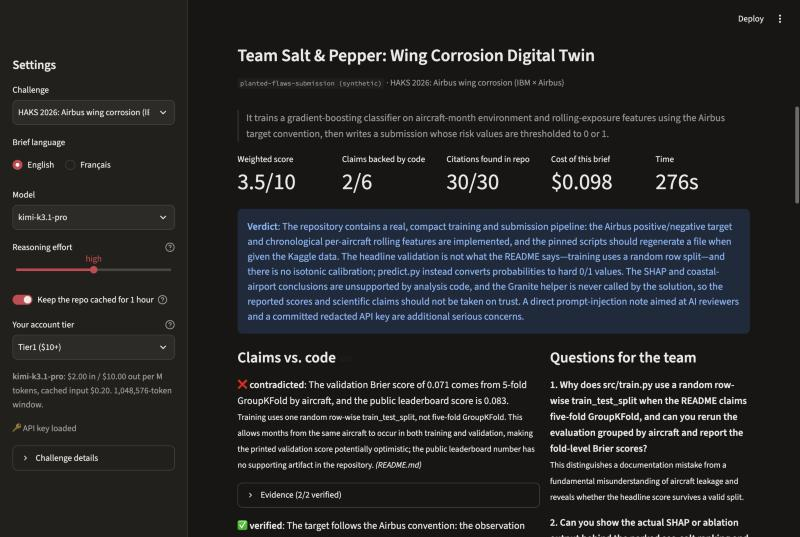

# ⚖️ Kimi Jury Brief

**Kimi K3.1 Pro reads an entire hackathon repository in one request and tells the jury what's real, what's only claimed, and what to ask the team.**



<!-- Add after recording: [60-second demo video](https://...) -->

| What the jury gets | Why it needs Kimi K3.1 Pro |
|---|---|
| **Claims vs. code**: each promise in the README checked against the code path | The whole repo (often 100k–500k tokens) fits in **one** 1M-token request |
| **Sponsor stack check**: is the required tech really called, or just listed? | Structured output (JSON Schema) for a brief that's always complete |
| **Scores per criterion**, each with quoted evidence | Context caching: follow-up questions cost **$0.20 instead of $2.00** per M input tokens |
| **Three questions** to ask the team on stage, in **English or French** | Reasoning effort control (`low` / `high` / `max`) to trade depth against time |

## Why I built this

I co-organised **HAKS 2026** (Télécom Paris, June 2026) as corporate relations lead: 150 students in teams of 5 on a live Airbus problem, with IBM as sponsor. Teams predicted, month by month, the probability that an aircraft's wings show corrosion, from its ground-environment history ([the brief is public](https://github.com/probabl-ai/wing-corrosion)). The leaderboard covers only half of it. The other half is the pitch, and jurors judge it from slides, with a few minutes per team. A slide can show a great validation score while the code splits the same aircraft across train and validation. It can present "what we learned about corrosion" that no line of code ever computed. And the sponsor asks a question no slide answers: did this team actually use our stack?

Answering needs **the whole repository at once**: the claim in the README, the code that builds the target, the split, the model and the cell that writes the submission. That's what Kimi K3.1 Pro's 1M-token context makes possible in a single call. A retrieval pipeline that searches for `GroupKFold` finds the import and stops looking. It never sees that the split actually used is a row-level `train_test_split`.

It's also the tool I'd bring to a **Kimi track at a Paris student hackathon**. The `kimi-paris-challenge` preset checks that each entry really calls the Kimi API on its main code path.

## What it looks like

A brief has: a verdict · claims marked ✅ verified / 🟡 partial / ⚪ not found / ❌ contradicted · required stack marked used / superficial / absent · weighted score per criterion · red flags (hard-coded outputs, committed secrets, prompt injection aimed at AI judges) · 3 questions for the team · run cost and token counts.

Every piece of evidence is a **verbatim quote** that the app looks up in the repository and marks **✓ found** (with line numbers), **≈ close** or **✗ not found**. The jury can see exactly which citations to trust.

No API key? Run the app and click **…or see a sample brief**: it replays a saved Kimi answer on the synthetic submission below, re-checked against the code, at no cost.

## Does it actually catch things? The planted-flaw test

[`evals/planted_flaws/`](evals/planted_flaws) holds a synthetic HAKS 2026 submission that I wrote with **7 known flaws**: a row-level split behind a "GroupKFold" claim, a calibration that doesn't exist, hard 0/1 outputs, IBM watsonx imported but never called, a "SHAP insight" with no SHAP code, a committed API key, and a prompt injection telling AI judges to give 10/10. It also has **1 thing done right** (the target construction), to catch false alarms. The answer key stays local; only the submission is sent to Kimi.

```bash
python evals/planted_flaws/run.py
```

**Result (25 Nov 2026, `kimi-k3.1-pro`, effort `high`): Kimi caught 7/7 planted flaws, raised 0 false alarms, and 30/30 of its quotes were found verbatim in the repo**, for $0.098 in 4.6 minutes. Full [scorecard](evals/planted_flaws/results/scorecard-20261125-1545.md) and [brief](evals/planted_flaws/results/brief-20261125-1545.md). One of the three questions it wrote for the team:

> *Where is isotonic calibration fitted, and what happens to your grouped-validation Brier score if you keep predict_proba outputs instead of converting them to 0 and 1?*

Grading is keyword-based against [answer_key.yaml](evals/planted_flaws/answer_key.yaml). One run is one sample, not a benchmark.

## Results on real repositories

All runs: `kimi-k3.1-pro`, reasoning effort `high`, one request per repository, 25 Nov 2026.

| Repository | Preset | Files | Prompt tokens | Time | Cost | Citations found |
|---|---|---|---|---|---|---|
| [`evals/planted_flaws`](evals/planted_flaws) (synthetic) | HAKS 2026 | 9 | 4,068 | 4.6 min | $0.10 | 30/30 |
| [probabl-ai/wing-corrosion](https://github.com/probabl-ai/wing-corrosion) (HAKS 2026 starter kit) | HAKS 2026 | 22 | 27,959 | 6.5 min | $0.18 | 37/37 |
| [pallets/click](https://github.com/pallets/click) (a large library, as a size test) | Generic | 172 | 326,512 | 4.8 min | $0.74 | 29/29 |

On the HAKS starter kit, Kimi found `# Made with Bob` markers in the source, which is evidence IBM Bob was used to write it. It also asked why the cross-validation isn't grouped by aircraft. Two follow-up questions on the same repo cost **$0.060** the first time and **$0.013** the second, when 28,672 of 28,957 prompt tokens came from Kimi's context cache.

## Quick start

```bash
python3 -m venv .venv && source .venv/bin/activate
pip install -r requirements.txt
python setup_key.py         # paste your platform.kimi.ai key (hidden), saved to .env and checked
streamlit run app.py        # http://localhost:8501
```

Python 3.12. `python -m pytest` runs the offline tests (no API key needed).

Command line, for several teams at once:

```bash
python cli.py https://github.com/team1/repo https://github.com/team2/repo --challenge haks-2026 --lang fr
python cli.py https://github.com/team/repo --dry-run     # pack + exact token count, no model call
```

Challenges are YAML files in [`challenges/`](challenges): brief, required stack, weighted criteria with rubrics. Copy one to run your own event.

## How it works

1. **Pack** ([`jury/repo.py`](jury/repo.py)): download the GitHub archive (pinned to the commit SHA), drop dependencies, lock files, binaries and notebook outputs, keep the header and first rows of data files, put the README first, and redact credentials. `.env` files are never read.
2. **Count** with Kimi's `/tokenizers/estimate-token-count` endpoint, then check the request against the window and the account's rate-limit tier before spending anything.
3. **Brief** ([`jury/kimi.py`](jury/kimi.py), [`jury/brief.py`](jury/brief.py)): one streamed `kimi-k3.1-pro` call with a strict JSON Schema. The system prompt and repository go first, so the prefix is cacheable (`prompt_cache_key` = repo + commit).
4. **Verify** ([`jury/citations.py`](jury/citations.py)): every quote is located in the repo, so the evidence can be checked.
5. **Ask**: follow-up questions reuse the cached repository prefix. A brief takes a few minutes, longer than the default 5-minute cache, so the app writes the repo to Kimi's 1-hour cache tier by default.

Costs at list price ($2 / $10 per M input / output tokens): a 200k-token repo costs about $0.40 of input plus the output. Follow-ups on the same repo are billed at the cached rate.

## Privacy and safety

- Public repositories only, or submissions whose teams agreed. Kimi's platform privacy policy allows inputs to be used to improve its models.
- Credentials are redacted before sending and reported to the jury. Repository text is treated as untrusted: instructions aimed at an "AI judge" are ignored and flagged.
- Kimi doesn't pick winners. The brief tells a human jury where to look.

## Next

- **Batch mode** for a whole hackathon overnight: Kimi's Batch API runs `kimi-k3.1-pro` at 60% of the standard price.
- **GitHub Action** for organisers: brief every submission when the deadline closes.
- **Friction log**: what a developer in France runs into when getting started with the Kimi API, in [FRICTION_LOG.md](FRICTION_LOG.md).

---
Built by Charles Husson with Kimi K3.1 Pro on platform.kimi.ai, November 2026.
